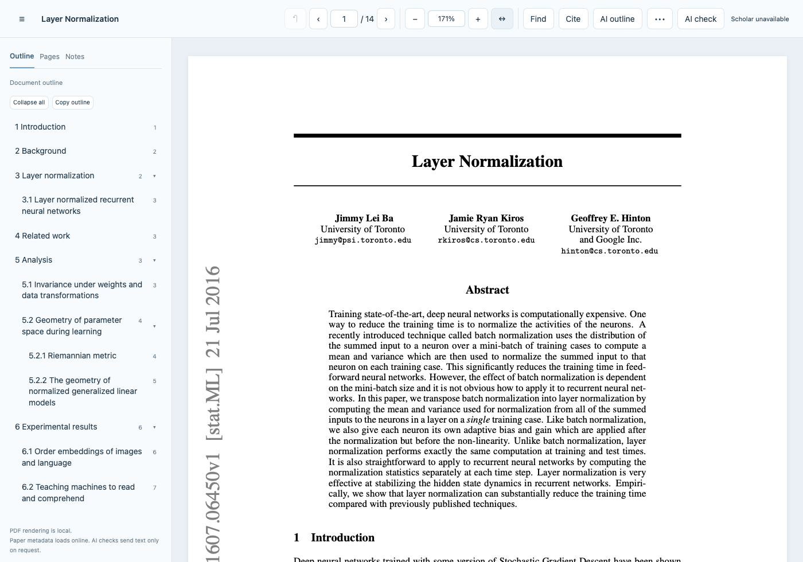
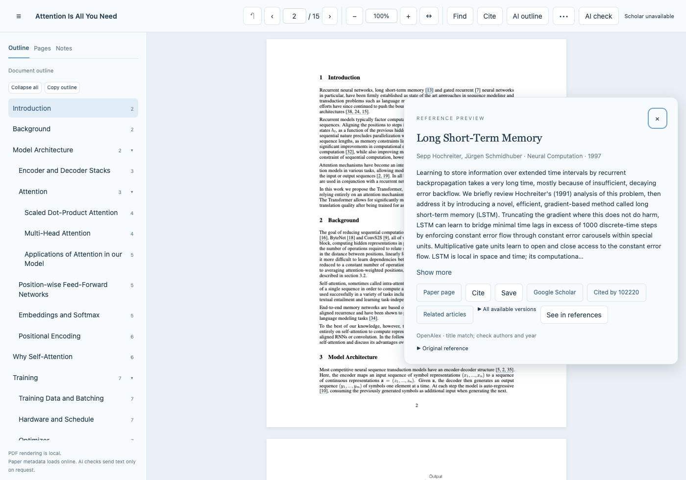

# safari_arxiv_reader

A Safari extension for reading research PDFs with a clickable section outline, reference previews, and quick access to cited papers. It enhances the PDF in its existing tab and keeps the original URL.



Click a citation to preview its title, authors, and abstract, then open an available PDF or export BibTeX. The reader also includes search, PDF zoom, page thumbnails, themes, and a local saved-paper library.



*Screenshots from the WebKit demo using public papers and recorded metadata; citation counts shown are illustrative.*

## Install in Safari

Requires **macOS 13 or later** and Apple Command Line Tools. The reader has been tested with Safari 18.6. This repository provides a **local development build**, not an App Store installation.

1. Install Apple's build tools with `xcode-select --install` if needed, and wait for installation to finish.
2. Clone and build:

   ```sh
   git clone https://github.com/zhouzypaul/safari_arxiv_reader.git
   cd safari_arxiv_reader
   bash scripts/build-local.sh
   open safari_arxiv_reader.app
   ```

3. In **Safari → Settings → Advanced**, enable **Show features for web developers**. Under **Developer**, enable **Allow unsigned extensions**.
4. In **Safari → Settings → Extensions**, enable **safari_arxiv_reader**. Allow access to **arxiv.org**. To display citation counts, also allow **scholar.google.com** under the extension's **Edit Websites…** settings.

Safari resets **Allow unsigned extensions** when it quits; enable it again for each new Safari session. Keep the built app in place. A permanent installation requires a signed distribution build; see [development instructions](docs/DEVELOPMENT.md).

## Use

- Open an arXiv PDF and reload it once after enabling the extension.
- Select a heading in **Outline** to jump to a section, or click an in-text citation to preview the reference.
- Use **Find**, pinch or **⌘+/⌘−** to zoom the PDF, and **Cite** to copy or download BibTeX.
- For another website's PDF, click the extension toolbar button → **Enhance this PDF** and allow that site. Choose **Open a local PDF** for downloaded files.
- **AI outline** and **AI check** are optional, off by default, and require your own service credentials. Ordinary headings work without AI.

Saved papers stay in this browser. Reference previews and citation counts use online metadata services; AI features send text only when requested. See [privacy and limitations](docs/PRIVACY.md), [release notes](CHANGELOG.md), and [third-party notices](THIRD-PARTY-NOTICES.txt).

## License

[MIT](LICENSE). Provided as is, without warranty. Bundled dependencies retain their own [licenses and notices](THIRD-PARTY-NOTICES.txt).

## Acknowledgements

This is a completely vibe-coded project built with GPT-6 Astra.
